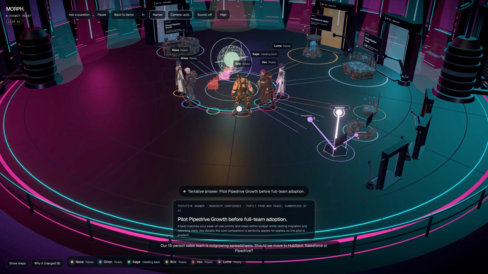
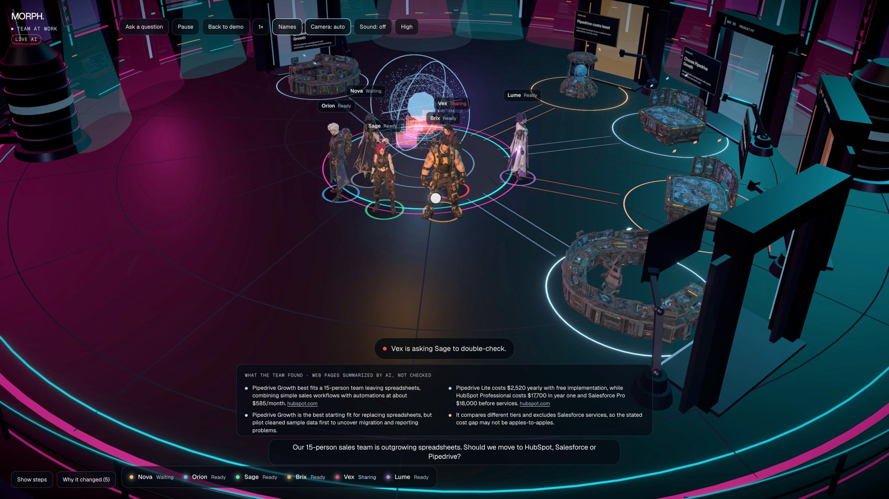

# MORPH

A 3D orbital deck where six specialised AI roles work through a real decision question together, and you can watch them do it.



MORPH is an experiment, not a product: a look at how visible, checkable and fast AI-assisted decision work can be when the architecture underneath is designed carefully.

## What happens

You ask a decision question, for example *"Our 15-person sales team is outgrowing spreadsheets. Should we move to HubSpot, Salesforce or Pipedrive?"*, and the team gets to work:

| Role | Agent | What it does |
| --- | --- | --- |
| Planner | Nova | Breaks the question into research tasks and asks you what matters |
| Researcher | Orion | Searches the web; every finding links to its source |
| Analyst | Sage | Combines the findings |
| Builder | Brix | Lays out the possible paths |
| Critic | Vex | Challenges the weakest finding and sends it back to be re-checked |
| Synthesizer | Lume | Writes the answer, its reasons and its risks |



Every movement on screen matches real work: an agent walks to a station because it was given a task, and a finding flies to another agent because it was handed over. Nothing moves just for decoration.

There are two modes:

- **Live:** real questions answered by an OpenAI model, with web search. It needs an API key.

## Design principles

- **The 3D scene only renders state.** Canonical workspace state, orchestration, AI providers, tools and visuals are separate layers.
- **AI output is never trusted blindly.** Every AI and tool response is validated with Zod at the boundary. The AI can only propose a fixed set of operations (`MorphOperation`), each validated before it is applied. AI-generated code or HTML is never executed.
- **Sources are kept apart from AI guesses.** Web findings carry their source link. Unsourced AI statements are labelled as such and never shown as verified evidence. Scenario scores are model assessments, not probabilities.
- **Limits are enforced on the server.** Each question has caps on model calls, retries, time per task, concurrency and spend, and keys stay server-side.
- **The same architecture serves both modes.** Live and sample runs share one workspace, operation and event model; the sample just replays deterministic fixtures.

More detail: [Architecture](docs/ARCHITECTURE.md) · [Event model](docs/EVENT_MODEL.md) · [Engineering principles](docs/ENGINEERING_PRINCIPLES.md) · [Visual system](docs/VISUAL_SYSTEM.md)

## Tech

Next.js 16 · React 19 · TypeScript (strict) · React Three Fiber / three.js · Zod · Zustand · Vitest · Playwright

## Running it locally

Requires Node 24.

```bash
npm install
cp .env.example .env.local   # add OPENAI_API_KEY to enable live questions (optional)
npm run dev
```

Open <http://localhost:3000>. Without a key, live questions are turned off, but the sample scenario at `/demo` still works.

Checks:

```bash
npm run typecheck && npm run lint && npm test && npm run build && npm run test:e2e
```

See [Local development](docs/LOCAL_DEVELOPMENT.md) for more.

## Credits

- Background music: "Cyberpunk Technology" by alexzavesa, via Pixabay (Pixabay Content License). See [`public/sound/CREDITS.md`](public/sound/CREDITS.md).
- Built with the help of AI coding tools.
